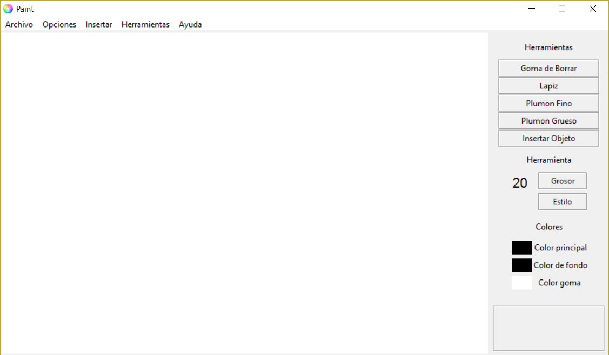
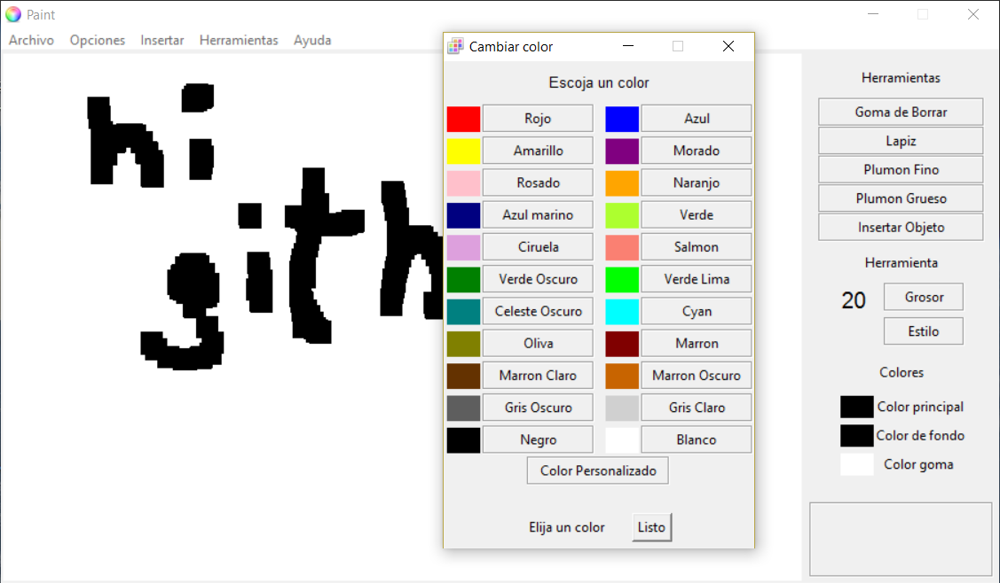

<h1 align="center">
  Python-Paint</h1>

Un sencillo Paint hecho en python

 

## Licencia

Este proyecto está licenciado bajo GPLv3 [https://www.gnu.org/licenses/]

## Autor

[Pablo Pizarro R.](https://ppizarror.com) | 2015
